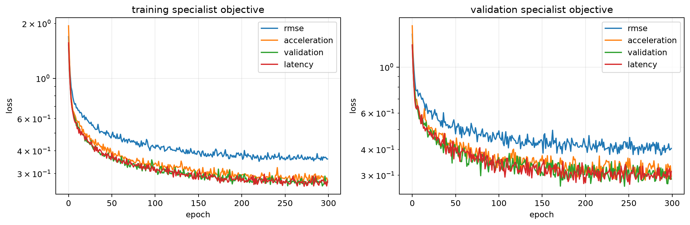

# Conditional Flow Matching for Berkeley UR5 Demonstrations

[](https://opensource.org/licenses/MIT) [](https://www.python.org/downloads/) [](https://pytorch.org/)

A PyTorch research baseline for generating **diverse UR5 state trajectories** from real [Berkeley Autolab UR5 demonstrations](https://huggingface.co/datasets/lerobot/berkeley_autolab_ur5). A conditional rectified-flow model generates a 32-step trajectory from a **start state, goal state, and task ID**. Four specialist teachers are combined into a velocity ensemble, then distilled into a faster single student.

## Demonstrations

### Generated robot positions

| Position 0 | Position 1 | Position 2 |
| :---: | :---: | :---: |
|  |  |  |
| Position 3 | Position 4 | Position 5 |
|  |  |  |

These robot visualizations are **inverse-kinematics reconstructions under assumed state-channel semantics**, not verified ground-truth joint recordings. The notebook also exports an interactive 3D animation (`Results/05_robot_reconstruction_animation.html`).

## Data and representation

The notebook reads `observation.state` and `task_index` from the dataset's Parquet files: **97,939 frames, 1,000 episodes, and 5 task IDs**. Each episode is resampled to **32 steps** and each recorded state has **8 channels**, producing a `(1000, 32, 8)` array. Tasks are one-hot encoded; 10% of episodes are held out for validation.

The eight dimensions are **not eight grippers**. The dataset columns do not identify the channels, but the notebook assumes **XYZ (3) + orientation quaternion (4) + gripper (1)** for visualization. This mapping has not been independently verified. The neural network learns all eight numerical channels jointly, with interior residuals shaped `[batch, 30, 8]`. Its generated outputs are state trajectories, not directly verified joint-space commands.

## Conditional flow matching

The model preserves the exact recorded endpoints by generating only the **30 interior residuals** around linear interpolation:

```text
reference(s) = (1-s) * start + s * goal
residual(s)  = trajectory(s) - reference(s)

x_t       = (1-t) * Gaussian_noise + t * residual
v_target  = residual - Gaussian_noise
loss_flow = MSE(model(t, x_t, start, goal, task), v_target)
```

A **dilated temporal ConvNet** predicts the velocity of every interior state channel, conditioned on sinusoidal flow-time features, start, goal and task. At inference, Euler integration transports new Gaussian noise into a residual trajectory, which is added back to the reference. Different noise samples can yield different paths. This is componentwise linear interpolation of normalized features, **not** shortest-angle joint interpolation.

## Ensemble and student distillation

Four **905,672-parameter** ConvNet teachers are trained for **300 epochs each** with different objectives:

| Teacher | Training objective |
| --- | --- |
| Reconstruction (`rmse`) | Flow MSE + 0.35 × reconstruction RMSE |
| Acceleration | Flow MSE + 0.30 × squared second differences |
| Validation | Standard flow MSE |
| Latency/base | Standard flow MSE; runtime only measured, not optimized |

At each ODE step, their **velocity predictions**, not their completed paths, are combined:

```text
v_ensemble = 0.30*v_rmse + 0.30*v_acceleration
           + 0.30*v_validation + 0.10*v_latency
```

A single same-sized student learns from **(1) ensemble velocities on student-visited flow states, (2) demonstration-supervised flow matching, and (3) smoothness regularization**:

```text
loss_student = loss_on_policy + 1.0*loss_flow + 0.1*loss_smoothness
```

Teachers are frozen during distillation. The resulting student needs only one network evaluation per ODE step instead of four.



## Results

Numbers below are from the attached notebook's benchmark; **lower is better**. Latency is for **one velocity-model forward pass**, not a full ODE rollout.

| Model | Parameters | Val. flow MSE ↓ | Rollout RMSE ↓ | Accel. RMS ↓ | Latency (ms) ↓ |
| --- | ---: | ---: | ---: | ---: | ---: |
| Base | 905,672 | **0.29846** | 0.5668 | 0.2635 | **0.706** |
| Ensemble | 3,622,688 | 0.29974 | 0.5593 | 0.2474 | 2.871 |
| Validation | 905,672 | 0.30387 | 0.5651 | 0.2650 | 0.708 |
| RMSE | 905,672 | 0.30406 | 0.5594 | 0.2656 | 0.726 |
| Acceleration | 905,672 | 0.31533 | 0.5692 | **0.2335** | **0.706** |
| **Student** | **905,672** | 0.31862 | **0.5571** | 0.2401 | 0.713 |

The student matches or improves rollout imitation relative to the ensemble in this benchmark using **one-quarter the parameters** and roughly **4× less forward-pass latency**. Its validation flow MSE is worse, however, and neither imitation RMSE nor acceleration RMS proves task success or collision safety.

## Run

Run the **Flow Matching Jupyter notebook** from the project root or `Code/` directory. Model checkpoints are written to `runs/`; plots, tables, and animations go to `Results/`.

**Limitations:** The eight-channel interpretation is an unverified visualization assumption; there are no obstacle maps or physical collision checks; validation normalization is computed before splitting the episodes; and held-out imitation metrics do not independently rule out memorization. A stronger study would fit normalization on training episodes only, test on genuinely unseen tasks or settings, and validate collisions and task completion using verified robot-state semantics.

## License

MIT.
